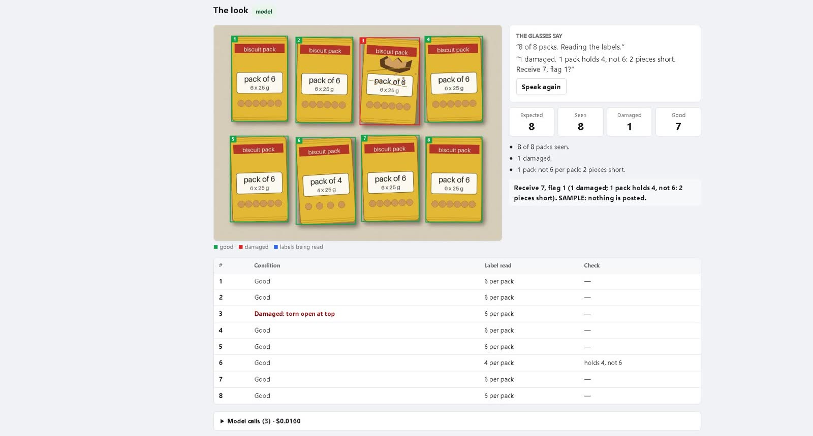
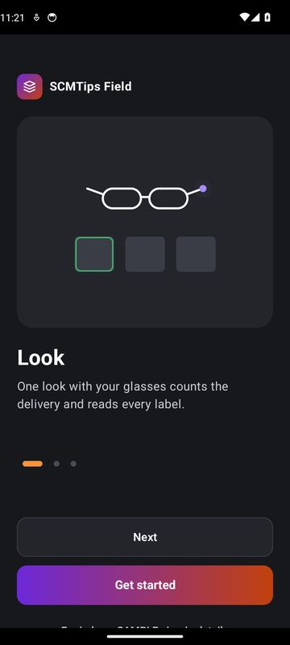
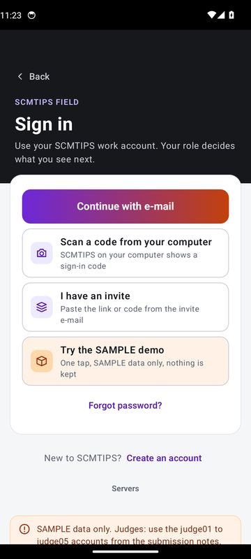
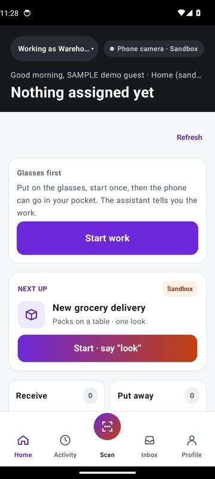
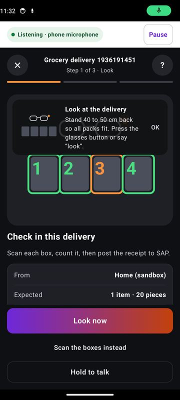
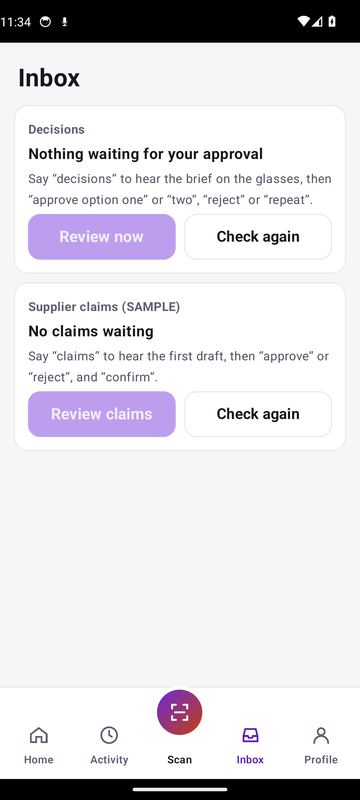
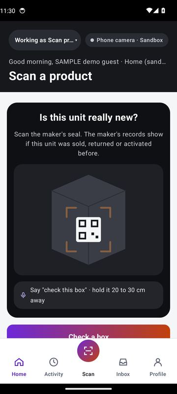

# SCMTips Field

[](https://github.com/mentorabhay/SCMTips-Field/actions/workflows/ci.yml)
[](https://github.com/mentorabhay/SCMTips-Field/actions/workflows/quickstart.yml)

**One look. It counts, reads and speaks. You confirm.** SCMTips Field turns Ray-Ban Meta glasses, or any Android
phone camera, into a hands-free check-in desk for deliveries. Meta's SAM 3.1 finds every item in the photo, Muse
Spark reads every label, plain rules check the numbers, and nothing is posted to the ERP until a person says the
numbers and "confirm". A second check answers the doorstep question "is this unit really new?" from the maker's
signed seal.

Built for the Meta Global AI Developer Hackathon (Indie track, "Build for Your World"), from 27 October 2026.

**Try it:** [Start guide, click by click](https://storage.googleapis.com/scmtips-field-judges/start-guide.html) ·
[Judge guide](https://storage.googleapis.com/scmtips-field-judges/judge-guide.html) ·
[Screenshot book and clips](https://storage.googleapis.com/scmtips-field-judges/book/index.html) ·
[Web console](https://hud.scmtips.com) ·
[Android app (APK)](https://github.com/mentorabhay/SCMTips-Field/releases/latest/download/field-hosted-apk.zip) ·
[Run it on your computer](#run-it-on-your-own-computer)



## What it does

A warehouse worker puts a delivery on a table and says "look". The glasses take one photo.

1. **Look.** Muse Spark names what is on the table and estimates how many; SAM 3.1 outlines and counts every pack,
   trying the words it answers to until its count agrees. Within seconds the glasses say "8 of 8 packs. Reading the labels."
2. **Hear.** Muse Spark reads each pack's label and condition. Fixed rules compare them with the order and the
   glasses say what they found: "1 damaged. 1 pack holds 4, not 6: 2 pieces short. Receive 7, flag 1?"
3. **Confirm.** The worker says their own numbers, then "post" and "confirm" within 10 seconds. What posts is always
   what the person said, never the model's guess: good units to the shelf, flagged units to quality, in one goods
   receipt, with a signed evidence page (the photo, the outlines, what was checked, and hashes that prove nothing
   was changed).

The same login also turns a problem into a supplier claim approved by voice, approves a supply-chain decision after
a spoken brief, and checks a seal label to say whether a "new" unit was really activated and returned before.

| | | |
|:-:|:-:|:-:|
|  |  |  |
| Welcome: look, hear, confirm | Sign in, or one tap for the SAMPLE demo | Warehouse home |
|  |  |  |
| The look, step 1 of 3 | Inbox: decisions and claims, by voice | Is this unit really new? |

All of it runs on SAMPLE data. The ERP is a simulator and the maker that signs the seals is simulated too.

## For judges

- **Start here:** the [start guide](https://storage.googleapis.com/scmtips-field-judges/start-guide.html) shows what to
  open on the laptop and the phone and every tap from install to the first spoken "look"; after that the voice takes over.
- **No install:** sign in on [hud.scmtips.com](https://hud.scmtips.com) and open **Try a look** to run the same look
  on a SAMPLE photo or your own. The judge accounts and their passwords are in the submission notes.
- **On an Android phone:** download the [APK](https://github.com/mentorabhay/SCMTips-Field/releases/latest/download/field-hosted-apk.zip),
  unzip it, install `app-hosted.apk`, and tap **Try the SAMPLE demo** (no account needed).
- **With Ray-Ban Meta (Gen 2) glasses:** the same app, hands-free. Turn on Developer Mode in the Meta AI app first.

The [judge guide](https://storage.googleapis.com/scmtips-field-judges/judge-guide.html) walks through every journey
(J1 to J7) and what you should see. The [screenshot book](https://storage.googleapis.com/scmtips-field-judges/book/index.html)
shows every phone screen and the recorded looks before you install anything.

## How it uses Meta's models and glasses

| Meta | What Field does with it |
|---|---|
| **SAM 3.1** (Meta Model API) | Finds and outlines every item in the photo: the count, and one numbered crop per item. |
| **Muse Spark 1.3** (Meta Model API) | Names the goods in the photo and estimates their count, so SAM is asked with a word it answers to (layer 1 of the look). Reads each numbered crop: pack size, batch, expiry, damage. Rewrites a decision's brief so it can be spoken; the platform's number check refuses any changed figure. |
| **Ray-Ban Meta (Gen 2)** through the Wearables Device Access Toolkit | The glasses' camera takes the look; the answers are spoken through the glasses; the worker answers by voice. |

Every model call goes through a budget guard with a daily cap, and the console shows what each look cost. Without a
model answer Field falls back to the person's own count: nothing ever posts on the model's word alone.

**Why two layers.** On real biscuit packs SAM 3.1 found 0 of 5 for the words "pack" and "box" and 5 of 5 for
"package"; on the SAMPLE photo "box" barely found 8 (confidence 0.60) and "package" found 8 at 0.88. So a look asks
SAM for the case's word while Muse names the goods and estimates the count; an empty or disagreeing answer makes SAM
try "package", "box" and Muse's words, and the answer nearest Muse's estimate is kept. The look's `reasons` say which
word counted (`instances:prompt:package`). Server settings: `VISION_NAMING` (default on), `VISION_NAMING_DEADLINE_S`
(10 s). The probes: [docs/evidence/runs/2026-11-04-look-two-layer-probe.md](docs/evidence/runs/2026-11-04-look-two-layer-probe.md).

## Settings and prerequisites (phone and glasses)

The app is **0.6.1-m5-hosted** or later (Profile › Settings › Advanced › Diagnostics › Version). Before a look works:

| Where | Set | Why |
|---|---|---|
| Meta AI app | Glasses paired, **Developer Mode** on | The Wearables toolkit refuses an unreleased app without it |
| Profile › Settings › Advanced › Connections › **Glasses camera** | Run the test once and **allow** the glasses camera when the Meta AI app asks | Without it every glasses photo fails; the automatic connection does not ask |
| Android › Apps › SCMTips Field | Microphone, Nearby devices, Notifications allowed; Battery **Unrestricted** | The work session listens in the background |
| Profile › Sign out / sign in | Within 8 hours of use | A sign-in lasts 8 hours; the app then says "Your sign-in has expired" |
| Settings › **Audio only** | Off to see the photo, outlines, count and the consent button | On: everything is spoken only |
| Settings › **Attention word** | Off (on: start every command with "Field") | On: other words are ignored |
| Settings › **Scanning with** | Glasses or Phone camera | Also decides which camera takes the look photo |

A look needs a **delivery job open** (Home › Test at home › **New grocery delivery** or **New pharmacy delivery**);
lay the goods **label side up**, in one layer, on a plain surface. On the hosted server a new grocery delivery
expects 8 packs of 6 pieces and a pharmacy delivery 5 boxes (`FIELD_CASE_GROCERY_UNITS`, `FIELD_CASE_GROCERY_PIECES`,
`FIELD_CASE_PHARMACY_UNITS`; unset: 20, 12 and 10).

Spoken commands: "look" (or "take a look", "take a photo"), "I agree", "receive 7, flag 1", "post", "yes", "make a
claim", "repeat", "stop work". A recogniser that gives no confidence score (some phones score every result 0) is
taken at the 0.80 floor; a word said twice in a row counts once. The app log (Diagnostics › App log) shows what was
heard (🎤 lines) and the glasses' camera link (`glasses:` lines).

An **unknown barcode becomes a new item** only on a sandbox site, with a receipt or count job open, during a work
session: the assistant asks "What is it?", and the answer adds a line and a SAMPLE material in the ERP simulator.

Known limits: folding the glasses during a work session pauses and restarts it (tap **Stop work** first); speech
is US English, offline.

## Run it on your own computer

Everything below runs on one computer with no account and no key: a stand-in for the SCMTIPS platform
(`tools/fake-core`) and a stand-in for Meta's models (`tools/dev_stack/model_standin.py`) take their places. The
[quickstart workflow](.github/workflows/quickstart.yml) runs exactly these steps on a fresh machine on every push.

You need **git**, **Docker**, **[uv](https://docs.astral.sh/uv/)** (it installs Python 3.13 itself) and
**Node.js 22** with pnpm 10 (`corepack enable`).

```bash
git clone https://github.com/mentorabhay/SCMTips-Field.git
cd SCMTips-Field

# 1. The database (Postgres 16 in Docker)
docker compose -f docker-compose.dev.yml up -d --wait postgres

# 2. Install
uv sync --frozen
pnpm install --frozen-lockfile

# 3. Start Field: field-api, the ERP simulator, the stand-in core and the model stand-in
uv run python -m tools.dev_stack.stack up --local-only --model-standin

# 4. Both looks end to end, as the phone would do them: grocery and pharmacy, post, claim, approval, evidence page
uv run python -m tools.dev_stack.stack smoke --m5 --wait 90

# 5. The supervisor console on http://localhost:3000 (PowerShell: $env:NEXT_PUBLIC_DEV_SIGNIN="1"; then the pnpm line)
NEXT_PUBLIC_DEV_SIGNIN=1 pnpm --dir apps/field-console dev
```

Then open:

- **The console:** http://localhost:3000 → **Development sign-in** → Supervisor. For the tenant id, copy `"tenant"`
  from `var/dev_stack.json`.
- **The simulated SAP:** http://127.0.0.1:8002/_sim/ui shows every document and stock change the smoke posted.

`uv run python -m tools.dev_stack.stack status` shows what runs, `stack down` stops it, and
`uv run python -m tools.dev_stack.stack --help` lists every job and smoke.

**With Meta's real models:** put `AI_CLOUD_ENABLED=true`, `MODEL_API_KEY=<your Meta Model API key>` and
`AI_ALLOW_UNCONFIRMED_PRICES=true` (image prices are not yet published, so the guard would refuse them) in
`.env.local`, then start without `--model-standin`. `AI_DAILY_CAP_USD` (default 3) caps the spend.

**With your phone:** start without `--local-only` so the phone can reach this computer on the same Wi-Fi, install the
debug APK (CI artifact `field-debug-apk`), and pair it with the QR code from
`uv run python -m tools.dev_stack.stack pair --home`.

[docs/SETUP/FIELD_TEST_GUIDE.md](docs/SETUP/FIELD_TEST_GUIDE.md) is the long version, for Windows, with the phone
and the glasses.

## How it fits together

```
 Ray-Ban Meta glasses ──(camera, audio)──► field-android ──HTTPS──► field-api ──► field-worker ──► erp-sim
                                           (Compose, CameraX)      (FastAPI,       (posting        (simulated
 field-console (Next.js) ─────────────────────────────────────────►  Postgres RLS)   engine)         S/4HANA OData)
                                                                        │
                                                Meta Model API ◄────────┤  SAM 3.1, Muse Spark 1.3 (budget guard)
                                                SCMTIPS platform ◄──────┘  sign-in and supply-chain decisions
                                                (tools/fake-core stands in on your computer)
```

The hosted demo connects Field to the SCMTIPS platform for sign-in and supply-chain decisions. That platform is not
part of this repository; its contract with Field is in [docs/EXCHANGE_CONTRACT.md](docs/EXCHANGE_CONTRACT.md), and
on your computer the stand-in core serves the same contract.

## What is in this repository

- `apps/field-android`: the phone app (Kotlin, Jetpack Compose, CameraX, the Wearables Device Access Toolkit).
- `apps/field-console`: the supervisor's web console (Next.js 15): live work, decisions, postings, sites and towers,
  devices, and the **Try a look** page.
- `services/field-api`: the backend (FastAPI): forced row-level security per tenant, idempotency keys, ETags,
  the vision look, the brief router, the budget guard and the evidence pages.
- `services/field-worker`: outbox events, material synchronisation and asynchronous ERP postings.
- `services/erp-sim`: a simulated S/4HANA OData ERP with real numbering ranges, locks, reversals and fault
  injection; it also hosts the simulated maker for the seal check.
- `connectors/sap`: the ERP port with a simulator adapter and an S/4HANA OData adapter.
- `packages/`: design tokens (WCAG 2.1 AA in light, dark and lens themes) and the OpenAPI contracts.
- `tools/fake-core`: the stand-in for the SCMTIPS platform; `tools/dev_stack`: the one-command stack and smokes.
- `docs/`: the [Meta feasibility register](docs/META_FIELD.md) (what was proven against Meta's API, and how),
  [evidence and run logs](docs/evidence/), [setup guides](docs/SETUP/), [design notes](docs/design/) and
  [decision records](docs/adr/).

## Quality gates

Every push runs [ci](.github/workflows/ci.yml): Ruff, Mypy strict and TypeScript strict; pytest (over 950 tests),
Vitest and property tests; schema-checked OpenAPI; migration round trips; Semgrep; the Android build, unit tests
and lint; an emulator launch of the app; and a trace gate that every task in the ledgers has a passing test.
`./scripts/verify-all.sh` runs the same jobs locally.

## Licence

SCMTips Field is free software under the [GNU Affero General Public License v3.0 or later](LICENSE)
(AGPL-3.0-or-later). You may use, change and share it. If you share a changed version, or run one for other people
over a network, you must publish its complete source code under the same licence, so nobody can turn it into a
closed product.

The licence covers the code, not the name: "SCMTips Field", "SCMTIPS" and the logo stay the project's own, and a
changed version must use its own name. See [NOTICE](NOTICE) for the copyright line, the rules for the name and logo,
and the reminder that everything here runs on SAMPLE data.
