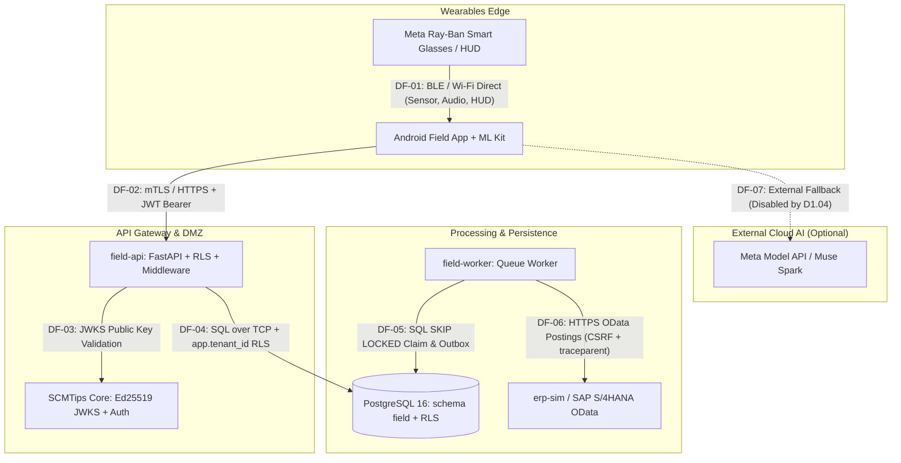

# SCMTIPS Field - Threat Model & STRIDE Analysis (Task T1.069 / FR1.061)

**Document Reference**: `docs/security/THREAT_MODEL.md`  
**Version**: 1.0.0  
**Phase**: Phase 1 Foundations  

> **Correction (C2 audit, 2026-10-30).** Several controls below are described as if implemented but are **not**:
> - SEC-CTRL-02: there is no frame SHA-256 in the capture payload from the glasses.
> - SEC-CTRL-05: TLS 1.3/HSTS are not configured. The field test runs plain http on the owner's LAN (debug builds only, private addresses only) or through an https tunnel.
> - SEC-CTRL-06: there is no per-tenant rate limiting, and no 10 MB clamp beyond the 1 MB crop upload limit.
> - SEC-CTRL-11: the "Muse API blocked from India" result was simulated and has been retracted (docs/META_FIELD.md).
>
> The cited test ids (e.g. TC1.153, TC1.011, TC1.014) have no tests behind them.
> Implemented since: JWKS-only token exchange with device binding, no built-in signing keys, RLS on the app role, the cloud-AI budget guard (off by default).
> T1.069 is **partial** in the ledger until this document is revised against the code.
**Target Architecture**: Glasses <-> Android Phone <-> field-api <-> field-worker <-> erp-sim / SAP S/4HANA <-> SCMTips Core  

---

## 1. System Architecture & Data Flow Diagram (DFD)

---

## 2. STRIDE Analysis per Data Flow

| Flow ID | Description | STRIDE Category | Threat Description | Control ID | Test ID | Residual Risk |
| :--- | :--- | :--- | :--- | :--- | :--- | :--- |
| **DF-01** | Glasses to Phone | **Spoofing** | Attacker spoofs rogue Bluetooth peripheral pairing with phone. | `SEC-CTRL-01`: Cryptographic device pairing, pinned public key, core device token. | `TC1.037` | Low. Pairing requires physical proximity and button hold. |
| **DF-01** | Glasses to Phone | **Tampering** | Man-in-the-Middle injection of fake barcode or sensor frames over Bluetooth. | `SEC-CTRL-02`: BLE link-layer encryption (AES-CCM) + frame SHA-256 hash in capture payload. | `TC1.153` | Low. Link layer encrypted by OS Bluetooth stack. |
| **DF-02** | Phone to field-api | **Spoofing** | Attacker submits telemetry without valid device token. | `SEC-CTRL-03`: `POST /v1/auth/exchange` validates core Ed25519 JWT and checks device revocation. | `TC1.036` | Low. Revoked devices rejected immediately. |
| **DF-02** | Phone to field-api | **Tampering** | Payload tampering or duplicate capture replay. | `SEC-CTRL-04`: 24-hour SHA-256 idempotency cache (`Idempotency-Key` header). | `TC1.015` | Very Low. Exact replay returns cached response. |
| **DF-02** | Phone to field-api | **Information Disclosure** | Interception of camera frames or warehouse barcodes in transit. | `SEC-CTRL-05`: Strict TLS 1.3 with AES-256-GCM; HSTS enabled. | `TC1.011` | Low. Standard TLS termination. |
| **DF-02** | Phone to field-api | **Denial of Service** | DoS attack flooding ingest endpoints. | `SEC-CTRL-06`: Per-tenant rate limiting and payload size clamping (max 10MB). | `TC1.014` | Medium. Fleet network QoS required in warehouse. |
| **DF-03** | field-api to Core | **Elevation of Privilege** | Attacker alters core roles or claims unauthorized tenant ID. | `SEC-CTRL-07`: Ed25519 JWKS signature verification; strict tenant claims extraction. | `TC1.035` | Low. Cryptographic signature cannot be forged. |
| **DF-04** | field-api to DB | **Information Disclosure** | Cross-tenant data leakage or bypass of warehouse site permissions. | `SEC-CTRL-08`: PostgreSQL RESTRICTIVE Row Level Security (`tenant_isolation`) and site scope triggers. | `PR1.04` | Very Low. Fail-closed multi-tenancy verified by property test. |
| **DF-05** | field-worker to DB | **Repudiation** | Conflicting posting jobs executed twice or status lost upon crash. | `SEC-CTRL-09`: Monotonic queue ordering `FOR UPDATE SKIP LOCKED`, atomic status updates, outbox audit log. | `TC1.149` | Very Low. Exactly-once queue claim semantics. |
| **DF-06** | field-worker to ERP | **Tampering / Repudiation** | Ghost postings or phantom documents created in SAP S/4HANA. | `SEC-CTRL-10`: SAP Idempotency-Key forwarding (`find_by_idempotency_key` pre-check), net stock conservation checks. | `PR1.07` | Very Low. SimAdapter & S4 adapter verify idempotent responses. |
| **DF-07** | Phone to Cloud AI | **Information Disclosure** | External cloud AI providers training on proprietary inventory images. | `SEC-CTRL-11`: Decision D1.04: Meta Muse Cloud API blocked from India; local on-device ML Kit & self-hosted Llama. | `TC1.151` | Negligible. Outbound cloud AI disabled by default. |

---

## 3. Residual Risks & Mitigations

1. **Physical Loss of Glasses / Phone**:
   - *Risk*: An operator loses glasses or phone in a warehouse yard.
   - *Mitigation*: Core device status polling (`T1.038`) and remote revocation via `POST /v1/devices/{id}/revoke`. Device JWTs expire within 600s.
2. **Offline Reconnection Storm**:
   - *Risk*: A batch of 50 workers reconnect simultaneously after Wi-Fi dead-zone transit.
   - *Mitigation*: Jittered exponential backoff and SKIP LOCKED worker pool scaling.
